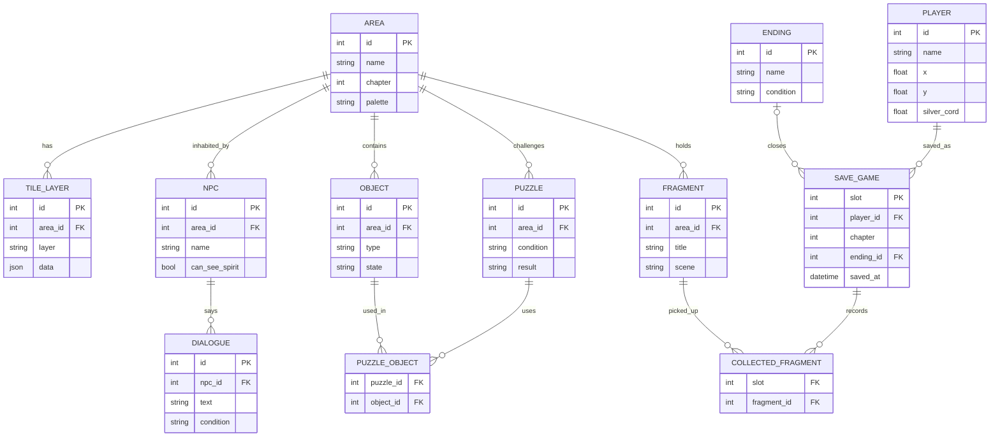

# PRD – Pixel Art Game: Tali Perak (EN)

[Bahasa Indonesia](PRD.md) · [English](PRD.en.md)

Oct 3, 2026 · @MJ Mokhtar

## Product overview

**Tali Perak** (working title, "The Silver Cord") is a 2D pixel art adventure game about the spirit of a person in a near-death state who must find the way back to their body before the "silver cord" connecting them snaps. Everything in this document is an initial proposal and can be changed.

- **Genre:** 2D top-down puzzle-adventure with exploration and a short story
- **Platform:** desktop browser (HTML5 Canvas); touch controls for mobile considered after the MVP
- **Target players:** casual to mid-core players who enjoy short indie narrative games
- **Tone:** sad, warm, and eerie at the same time
- **Design pillars:**
  1. Going home is the only goal; every area brings the player closer to, or further from, the body
  2. Time pressures gently, never with panic
  3. One world, two layers: the real world and the spirit world
  4. Sad but warm, with a touch of the eerie present at the same time

## Background and story premise

The protagonist is 28 years old (the player chooses the name at the start of the game; this document calls them Laras). Laras is in a road accident on a rainy night. Her body is taken to the hospital and falls into a near-death state, while her spirit wakes up alone at the crash site.

A thin glowing cord links her spirit to her body. The cord keeps shortening, and if it runs out, the spirit can never return. To go home, Laras must cross a fictional city in a far-off, nowhere world, pass through her own house, and finally enter the hospital where her body lies.

Along the way she finds memory fragments that reveal who she is, who is waiting for her, and what makes her want (or hesitate) to return.

## Goals and non-goals

The product aims to deliver a complete 20 to 30 minute experience (MVP) with an opening, challenges, and an emotional ending.

**Goals**

- Players understand the spirit mechanics within the first 2 minutes without a long tutorial
- Players feel time pressure through the shrinking silver cord
- The story is delivered through memory fragments, not long text
- All graphics are generated from code (pixel grids + palettes), with no external image assets
- Three endings from the start of the design

**Non-goals (first version)**

- No multiplayer
- No weapon combat; challenges are puzzles and evasion; no jump scares, the eerie feeling is built through animations of ghosts attacking the player
- No third-party characters, music, or assets
- Player customization is the name only; the character's appearance is fixed

## Core gameplay and mechanics

The player controls a spirit floating through a two-layer world, collecting memory fragments to open the path to their body while keeping the silver cord from running out.

| Mechanic | How it works | Role in the game |
| --- | --- | --- |
| Floating and phasing through walls | The spirit moves in 8 directions and passes through ordinary walls | Shortcuts and exploration |
| Blessed walls | Salt, mirrors, or certain marks block the spirit | Puzzles: find another route |
| Possessing objects | Pressing the action button near a small object (lamp, door, radio) moves it briefly | Unlocks mechanisms and draws attention |
| Memory fragments | Light shards scattered across each area; touching one plays a short scene | Story and the requirement to open the next chapter |
| Silver cord | A meter that drains over time and when touching danger | Time pressure and the lose condition |
| Light points (candles, lamps, prayers) | Standing near them slowly restores the cord | Rest spots and route decisions |
| Seen by the living | Only small children and pets can see the spirit | Unique interactions and hints |
| Ghost attack | When a hostile ghost catches the player, a dedicated attack animation plays and the cord shrinks | Danger without jump scares |

## World structure and story progression

The game takes place in a fictional city in a far-off, nowhere world, with no real-world countries or places. It has five chapters in order, each one area, with one constant goal: get closer to the body.

| Chapter | Area | Core challenge | Memory fragment |
| --- | --- | --- | --- |
| 1 | Crash site | Learning to float and phase through walls | The night of the accident |
| 2 | City streets at night | Blessed walls, streetlights as light points | Work and friends |
| 3 | Her own house | Possessing objects, meeting the pet | Family |
| 4 | Hospital lobby and corridors | Avoiding the guardian spirit, visiting hours | Regret |
| 5 | Intensive care room | Final puzzle in front of her own body | Decision |

**Three endings** are decided by the number of memory fragments and the choice in chapter 5:

- **Going home:** the player returns to the body and wakes up
- **Letting go:** the spirit accepts the departure and says goodbye to those waiting
- **Lost:** the silver cord runs out before arriving

## Characters, NPCs, and enemies

All characters are original and designed to read clearly at small sprite sizes.

| Name (working) | Role | Design notes |
| --- | --- | --- |
| Laras | Protagonist, spirit; name chosen by the player (Laras = default), fixed appearance | Translucent bluish silhouette, sways gently while floating |
| Bima | Neighbor's child | The only human who can see Laras; gives hints |
| House cat | Pet | Can see spirits; opens the way in chapter 3 |
| Mother / family | People behind the memories | Appear in memory fragments and the waiting room |
| Night nurse | Hospital human | Cannot see the spirit; patrol pattern becomes a puzzle |
| Threshold Guardian (Penjaga Ambang) | Chapter 4 guardian spirit | Patrols; if it catches the player, the ghost attacks with a dedicated animation and drains the silver cord |
| Lost spirit | Neutral NPC | Gives hints in exchange for one fragment |

## Pixel art direction

The visual style uses a low internal resolution scaled by whole numbers, with two palettes to separate the real world from the spirit world.

| Aspect | Proposal |
| --- | --- |
| Internal resolution | 320 x 180 pixels, scaled in integer steps with no smoothing |
| Tile size | 16 x 16 pixels |
| Character sprite size | 16 x 24 pixels |
| Real-world palette | 16 colors, cool: dark blue, gray, lamp yellow |
| Spirit-world palette | Teal, purple, and glowing white; the spirit is semi-transparent |
| Animation | Idle 2 frames, floating 4 frames, cord and fragment effects 3 frames |
| UI | Silver cord meter at the top corner, pixel dialogue boxes, bitmap font |
| Sprite creation | Written as pixel matrices in code; can be replaced by hand-drawn art (Aseprite or Piskel) later |

## Audio and atmosphere

Audio is original and generated with the Web Audio API, so no external sound files are needed.

- **Music:** simple, slow chiptune tones; echo added in the spirit world
- **Sound effects:** floating footsteps, fragment pickup, a heartbeat when the cord runs low
- **Atmosphere:** deliberate silence in emotional moments, warm tones blended with eerie elements (shadows, whispers), heartbeat speeds up when the cord is below 25%
- **Audio controls:** mute button and volume control from the MVP

## Functional and technical requirements

The MVP runs fully in the browser with plain JavaScript and HTML5 Canvas, with no extra dependencies, so it is easy to run and learn from.

- **Stack:** HTML, JavaScript ES modules, Canvas 2D; a build tool or framework is added only if truly needed
- **Game loop:** fixed time-step update, 60 FPS rendering
- **Controls:** arrow keys or WASD to move, Z or Space for action, Esc to pause
- **Maps:** tile maps as arrays/JSON per area, with a real-world layer and a spirit-world layer
- **Collision:** simple boxes (AABB); blessed walls and ordinary walls differ by tile attribute
- **Saving progress:** `localStorage` per slot (chapter, fragments collected, position, silver cord)
- **Audio:** Web Audio API
- **Performance:** steady 60 FPS on an ordinary laptop; all assets under 1 MB because they are drawn from code
- **Language:** Indonesian in-game, text kept in a single file so it can be translated

## Data structure and ERD

Ten main entities support the game; this is the starting material for the ERD before any code is written.

| Entity | Main attributes | Relations |
| --- | --- | --- |
| Player | x/y position, silver cord, form (spirit/body) | has many collected Fragments |
| Area | id, name, chapter, palette | has many Tile layers, Objects, NPCs |
| TileLayer | area\_id, layer (real/spirit), tile data | belongs to Area |
| Object | id, type (lamp, door, radio), state, area\_id | linked to Puzzles |
| Fragment | id, area\_id, title, scene | collected by Player |
| NPC | id, name, can\_see\_spirit, area\_id | has Dialogue |
| Dialogue | id, npc\_id, text, condition | belongs to NPC |
| Puzzle | id, area\_id, condition, result (opens a path) | uses Objects and Fragments |
| SaveGame | slot, chapter, collected fragments, silver cord, save time | records Player |
| Ending | id, condition (fragment count, choice) | determined from SaveGame |

### ERD

Every area entity (tiles, objects, NPCs, fragments, puzzles) points to Area through `area_id`; two join tables are needed for the many-to-many relations.



`ending_id` in SAVE\_GAME stays empty until the player reaches one of the three endings.

There is no server database. Static data (areas, dialogue, fragments, endings) is read from JSON files in the `data/` folder, while PLAYER, SAVE\_GAME, and COLLECTED\_FRAGMENT are stored in the player's browser `localStorage`.

## Proposed folder structure

This structure has not been used for any code yet; please confirm or change it first.

```text
tali-perak/
├── index.html
├── src/
│   ├── main.js
│   ├── core/        loop, input, camera, audio, save progress
│   ├── world/       areas, tile map, collision
│   ├── entities/    player, ghost, npc, object
│   ├── systems/     silver cord, fragments, puzzles, dialogue
│   ├── ui/          hud, dialogue box, menu, name input
│   └── art/         color palette, sprites (pixel matrices)
├── data/
│   ├── areas/       chapter1.json, chapter2.json, ...
│   ├── dialogue.id.json
│   ├── fragments.json
│   └── endings.json
└── README.md
```

No `package.json` and no build tool in the early stage; just an `index.html` that loads the JavaScript modules, served by a simple static server.

## MVP scope and work stages

The MVP covers chapters 1 and 2 and the framework for three endings (all three finished in stage 6), enough to test whether the feeling of "going home" and the pressure of the silver cord are fun.

| Stage | Content | Testable result |
| --- | --- | --- |
| 0 | PRD, ERD, folder structure agreed | Document approved |
| 1 | Game loop, camera, floating movement, tile map | Spirit can move in one room |
| 2 | Wall phasing, blessed walls, silver cord | Core mechanic feels right |
| 3 | Full chapter 1: fragments, dialogue, light points | One area can be completed |
| 4 | Chapter 2: object possession, first puzzle | 20 to 30 minute MVP |
| 5 | Audio, saving progress, visual polish | Ready to share |
| 6 | Chapters 3 to 5 and the three endings | Full version |

**MVP success measures (proposed):**

- New players finish chapter 1 without help
- Average session length of 20 minutes or more
- At least 7 out of 10 testers say they want to know what happens next

## Risks, assumptions, and decisions

**Risks**

- Time pressure can feel annoying if the silver cord drains too fast; needs testing and tuning
- Wall-phasing puzzles can be too easy since players can pass through almost anywhere
- Sprites drawn from code are limited in quality compared with hand-drawn art

**Assumptions**

- Desktop browser platform, Indonesian in-game language, no extra dependencies
- Names, supporting characters, and setting are placeholders that can be replaced

**MJ's decisions**

- [x] Tone: sad, warm, and eerie together
- [x] Setting: a fictional city in a far-off, nowhere world
- [x] The player chooses the protagonist's name
- [x] Three endings from the start of the design
- [x] No jump scares; eeriness through animations of ghosts attacking the player
- [x] Customization is the name only; appearance stays fixed
- [x] After the PRD is approved, continue to the ERD and folder structure before any code
- [ ] Confirm the folder structure above
