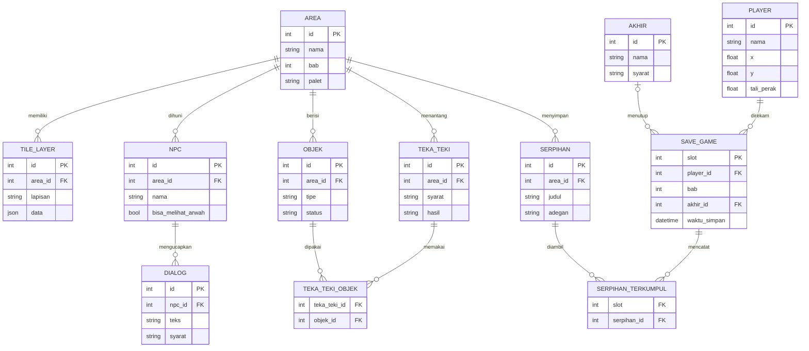

# PRD – Game Pixel Art: Arwah Mati Suri

[Bahasa Indonesia](PRD.md) · [English](PRD.en.md)

Oct 3, 2026 · @MJ Mokhtar

## Ringkasan produk

**Tali Perak** (judul sementara) adalah game petualangan 2D pixel art tentang arwah seseorang yang mati suri dan harus menemukan jalan kembali ke tubuhnya sebelum "tali perak" yang menghubungkan keduanya putus. Semua isi dokumen ini adalah usulan awal yang bisa diubah.

- **Genre:** puzzle-adventure 2D top-down dengan eksplorasi dan cerita pendek
- **Platform:** browser desktop (HTML5 Canvas); kontrol sentuh untuk mobile dipertimbangkan setelah MVP
- **Target pemain:** pemain casual hingga menengah yang menyukai game naratif pendek bergaya indie
- **Pilar desain:**
  1. Pulang adalah satu-satunya tujuan, setiap area mendekatkan atau menjauhkan pemain dari tubuhnya
  2. Waktu menekan dengan lembut, bukan dengan panik
  3. Satu dunia, dua lapisan: dunia nyata dan dunia arwah
  4. Sedih tapi hangat, dengan sentuhan seram yang hadir bersamaan

## Latar belakang dan premis cerita

Protagonis berusia 28 tahun (namanya dipilih pemain di awal game; di dokumen ini disebut Laras), mengalami kecelakaan di jalan raya pada malam hujan. Tubuhnya dibawa ke rumah sakit dan jatuh ke kondisi mati suri, sementara arwahnya terbangun sendirian di lokasi kecelakaan.

Sebuah tali tipis berpendar menghubungkan arwahnya ke tubuh. Tali itu terus memendek, dan jika habis, arwah tidak bisa kembali. Untuk pulang, Laras harus menyeberangi kota fiktif di dunia antah berantah, melewati rumahnya sendiri, lalu masuk ke rumah sakit tempat tubuhnya terbaring.

Di sepanjang jalan ia menemukan serpihan ingatan yang menjelaskan siapa dirinya, siapa yang menunggunya, dan apa yang membuatnya ingin (atau ragu) untuk kembali.

## Tujuan dan non-tujuan

Produk ini bertujuan memberi pengalaman 20 sampai 30 menit (MVP) yang utuh: ada pembukaan, tantangan, dan akhir yang emosional.

**Tujuan**

- Pemain memahami mekanik arwah dalam 2 menit pertama tanpa tutorial panjang
- Pemain merasakan tekanan waktu lewat tali perak yang memendek
- Cerita tersampaikan lewat serpihan ingatan, bukan teks panjang
- Seluruh grafis dibuat dari kode (grid piksel + palet), tanpa aset gambar eksternal

**Non-tujuan (untuk versi awal)**

- Tidak ada multiplayer
- Tidak ada pertarungan senjata; tantangan berupa teka-teki dan menghindar; tanpa jump scare, rasa seram dibangun lewat animasi hantu yang menyerang pemain
- Tidak memakai karakter, musik, atau aset milik pihak lain

## Gameplay inti dan mekanik

Pemain mengendalikan arwah yang melayang di dunia dua lapisan, mengumpulkan serpihan ingatan untuk membuka jalan menuju tubuhnya sambil menjaga tali perak tetap panjang.

| Mekanik | Cara kerja | Fungsi dalam game |
| --- | --- | --- |
| Melayang dan tembus dinding | Arwah bergerak 8 arah dan melewati dinding biasa | Jalan pintas dan eksplorasi |
| Dinding berkat | Garam, cermin, atau tanda tertentu menahan arwah | Teka-teki: cari jalan memutar |
| Merasuki benda | Menekan tombol aksi di dekat benda kecil (lampu, pintu, radio) untuk menggerakkannya sebentar | Membuka mekanisme dan menarik perhatian |
| Serpihan ingatan | Pecahan cahaya tersebar di tiap area; disentuh memutar adegan singkat | Cerita dan syarat membuka pintu bab berikutnya |
| Tali perak | Meter yang berkurang seiring waktu dan saat menyentuh hal berbahaya | Tekanan waktu dan kondisi kalah |
| Titik cahaya (lilin, lampu, doa) | Berdiri di dekatnya memulihkan tali perak sedikit demi sedikit | Tempat istirahat dan keputusan rute |
| Dilihat makhluk hidup | Hanya anak kecil dan hewan peliharaan yang bisa melihat arwah | Interaksi unik dan petunjuk |

## Struktur dunia dan progres cerita

Latar game adalah kota fiktif di dunia antah berantah, tanpa negara atau tempat nyata. Game terdiri dari lima bab berurutan, masing-masing satu area, dengan satu tujuan tetap: bergerak lebih dekat ke tubuh.

| Bab | Area | Inti tantangan | Serpihan ingatan |
| --- | --- | --- | --- |
| 1 | Lokasi kecelakaan | Belajar melayang dan tembus dinding | Malam kecelakaan |
| 2 | Jalanan kota malam | Dinding berkat, lampu jalan sebagai titik cahaya | Pekerjaan dan teman |
| 3 | Rumah sendiri | Merasuki benda, bertemu hewan peliharaan | Keluarga |
| 4 | Lobi dan lorong rumah sakit | Menghindari arwah penjaga, jam kunjungan | Penyesalan |
| 5 | Ruang perawatan intensif | Teka-teki terakhir di depan tubuh sendiri | Keputusan |

**Tiga akhir** ditentukan oleh jumlah serpihan ingatan dan pilihan di bab 5:

- **Pulang:** pemain kembali ke tubuh dan terbangun
- **Melepas:** arwah menerima kepergian dan berpamitan dengan orang yang menunggu
- **Tersesat:** tali perak habis sebelum sampai

## Karakter, NPC, dan musuh

Semua karakter orisinal dan dirancang agar terbaca jelas pada sprite kecil.

| Nama (sementara) | Peran | Catatan desain |
| --- | --- | --- |
| Laras | Protagonis, arwah; nama dipilih pemain (Laras = nama bawaan), penampilan tetap | Siluet transparan kebiruan, bergoyang pelan saat melayang |
| Bima | Anak tetangga | Satu-satunya manusia yang bisa melihat Laras; pemberi petunjuk |
| Kucing rumah | Hewan peliharaan | Bisa melihat arwah; membuka jalan di bab 3 |
| Ibu / keluarga | Tokoh di balik ingatan | Muncul di serpihan ingatan dan ruang tunggu |
| Perawat jaga | Manusia di rumah sakit | Tidak melihat arwah; pola patroli jadi teka-teki |
| Penjaga Ambang | Arwah penjaga bab 4 | Berpatroli; jika menangkap pemain, hantu menyerang dengan animasi khusus dan mengurangi tali perak |
| Arwah tersesat | NPC netral | Memberi petunjuk dengan imbalan satu serpihan |

## Arah visual pixel art

Gaya visual memakai resolusi rendah yang di-scale bulat, dengan dua palet untuk membedakan dunia nyata dan dunia arwah.

| Aspek | Usulan |
| --- | --- |
| Resolusi internal | 320 x 180 piksel, di-scale kelipatan bulat tanpa smoothing |
| Ukuran tile | 16 x 16 piksel |
| Ukuran sprite karakter | 16 x 24 piksel |
| Palet dunia nyata | 16 warna, dingin: biru tua, abu, kuning lampu |
| Palet dunia arwah | Teal, ungu, dan putih berpendar; arwah semi-transparan |
| Animasi | Idle 2 frame, melayang 4 frame, efek tali perak dan serpihan 3 frame |
| UI | Meter tali perak di sudut atas, dialog dengan kotak piksel, font bitmap |
| Pembuatan sprite | Ditulis sebagai matriks piksel di kode; bisa diganti hasil gambar tangan (Aseprite atau Piskel) nanti |

## Audio dan suasana

Audio dibuat orisinal dan dihasilkan lewat Web Audio API, sehingga tidak butuh file suara eksternal.

- **Musik:** nada sederhana bergaya chiptune yang pelan; di dunia arwah ditambah gema
- **Efek suara:** langkah melayang, serpihan terambil, detak saat tali perak menipis
- **Suasana:** hening yang disengaja di momen emosional, nada hangat berpadu dengan elemen seram (bayangan, bisikan), kecepatan detak naik saat tali perak di bawah 25%
- **Kontrol audio:** tombol bisu dan pengatur volume sejak MVP

## Kebutuhan fungsional dan teknis

MVP berjalan penuh di browser dengan JavaScript murni dan HTML5 Canvas, tanpa dependensi tambahan, agar mudah dijalankan dan dipelajari.

- **Stack:** HTML, JavaScript modul (ES modules), Canvas 2D; build tool atau framework hanya ditambah jika benar-benar dibutuhkan
- **Game loop:** update dengan langkah waktu tetap, render 60 FPS
- **Kontrol:** panah atau WASD untuk bergerak, Z atau Spasi untuk aksi, Esc untuk jeda
- **Peta:** tile map dalam array/JSON per area, dengan layer dunia nyata dan layer dunia arwah
- **Tabrakan:** kotak sederhana (AABB); dinding berkat dan dinding biasa dibedakan oleh atribut tile
- **Simpan progres:** `localStorage` per slot (bab, serpihan terkumpul, posisi, tali perak)
- **Audio:** Web Audio API
- **Performa:** tetap 60 FPS di laptop biasa; seluruh aset di bawah 1 MB karena digambar dari kode
- **Bahasa:** Bahasa Indonesia, teks dipisah di satu berkas agar mudah diterjemahkan

## Struktur data (calon ERD)

Sepuluh entitas utama menopang game; ini bahan awal untuk ERD sebelum kode ditulis.

| Entitas | Atribut utama | Relasi |
| --- | --- | --- |
| Player | posisi x/y, tali\_perak, wujud (arwah/tubuh) | punya banyak Serpihan terkumpul |
| Area | id, nama, bab, palet | punya banyak Tile layer, Objek, NPC |
| TileLayer | area\_id, lapisan (nyata/arwah), data tile | milik Area |
| Objek | id, tipe (lampu, pintu, radio), status, area\_id | terhubung ke Teka-teki |
| Serpihan | id, area\_id, judul, adegan | dikumpulkan Player |
| NPC | id, nama, bisa\_melihat\_arwah, area\_id | punya Dialog |
| Dialog | id, npc\_id, teks, syarat | milik NPC |
| Teka-teki | id, area\_id, syarat, hasil (buka jalan) | memakai Objek dan Serpihan |
| SaveGame | slot, bab, serpihan\_terkumpul, tali\_perak, waktu simpan | merekam Player |
| Akhir | id, syarat (jumlah serpihan, pilihan) | ditentukan dari SaveGame |

### ERD

Setiap entitas area (tile, objek, NPC, serpihan, teka-teki) menunjuk ke Area lewat `area_id`; dua tabel penghubung dibutuhkan untuk relasi banyak-ke-banyak.



`akhir_id` di SAVE\_GAME kosong sampai pemain mencapai salah satu dari tiga akhir.

Tidak ada database server. Data statis (area, dialog, serpihan, akhir) dibaca dari berkas JSON di folder `data/`, sedangkan PLAYER, SAVE\_GAME, dan SERPIHAN\_TERKUMPUL disimpan di `localStorage` browser pemain.

## Usulan struktur folder

Struktur ini belum dipakai untuk kode apa pun; mohon dikonfirmasi atau diubah dulu.

```text
tali-perak/
├── index.html
├── src/
│   ├── main.js
│   ├── core/        loop, input, kamera, audio, simpan progres
│   ├── world/       area, tile map, tabrakan
│   ├── entities/    player, hantu, npc, objek
│   ├── systems/     tali perak, serpihan, teka-teki, dialog
│   ├── ui/          hud, kotak dialog, menu, input nama
│   └── art/         palet warna, sprite (matriks piksel)
├── data/
│   ├── areas/       bab1.json, bab2.json, ...
│   ├── dialog.id.json
│   ├── serpihan.json
│   └── akhir.json
└── README.md
```

Tanpa `package.json` dan tanpa build tool di tahap awal; cukup `index.html` yang memuat modul JavaScript, dijalankan lewat server statis sederhana.

## Ruang lingkup MVP dan tahap pengerjaan

MVP mencakup bab 1 dan 2 dan kerangka tiga akhir (ketiganya selesai di tahap 6), cukup untuk menguji apakah rasa "pulang" dan tekanan tali perak sudah menyenangkan.

| Tahap | Isi | Hasil yang bisa diuji |
| --- | --- | --- |
| 0 | PRD, ERD, struktur folder disepakati | Dokumen disetujui |
| 1 | Game loop, kamera, gerak melayang, tile map | Arwah bisa bergerak di satu ruangan |
| 2 | Tembus dinding, dinding berkat, tali perak | Mekanik inti terasa |
| 3 | Bab 1 lengkap: serpihan, dialog, titik cahaya | Satu area bisa diselesaikan |
| 4 | Bab 2: merasuki benda, teka-teki pertama | MVP 20 sampai 30 menit |
| 5 | Audio, simpan progres, polesan visual | Siap dibagikan |
| 6 | Bab 3 sampai 5 dan tiga akhir | Versi penuh |

**Ukuran keberhasilan MVP (usulan):**

- Pemain baru menyelesaikan bab 1 tanpa bantuan
- Rata-rata sesi bermain 20 menit atau lebih
- Minimal 7 dari 10 penguji menyebut ingin tahu kelanjutan ceritanya

## Risiko, asumsi, dan pertanyaan terbuka

**Risiko**

- Tekanan waktu bisa terasa menyebalkan jika tali perak terlalu cepat habis; perlu uji dan penyesuaian
- Teka-teki tembus dinding bisa terlalu mudah karena pemain bisa lewat hampir di mana saja
- Sprite digambar dari kode terbatas kualitasnya dibanding gambar tangan

**Asumsi**

- Platform browser desktop, bahasa Indonesia, tanpa dependensi tambahan
- Nama, tokoh, dan latar adalah placeholder yang boleh diganti

**Keputusan M****J**

- [x] Nuansa: sedih, hangat, dan seram bersamaan
- [x] Latar: kota fiktif di dunia antah berantah
- [x] Nama protagonis dipilih pemain
- [x] Tiga akhir sejak awal perancangan
- [x] Tanpa jump scare; rasa seram lewat animasi hantu yang menyerang pemain
- [x] Kustomisasi pemain hanya nama; penampilan karakter tetap
- [x] Setelah PRD disetujui, lanjut ke ERD dan struktur folder sebelum kode
